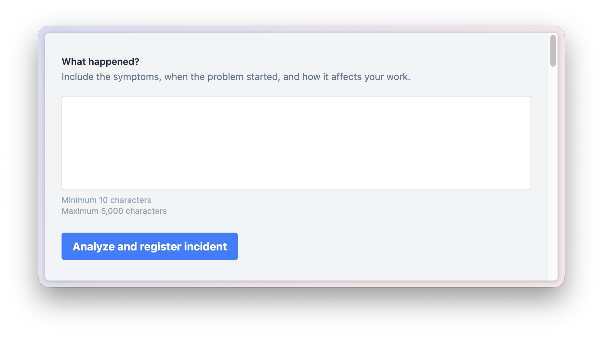
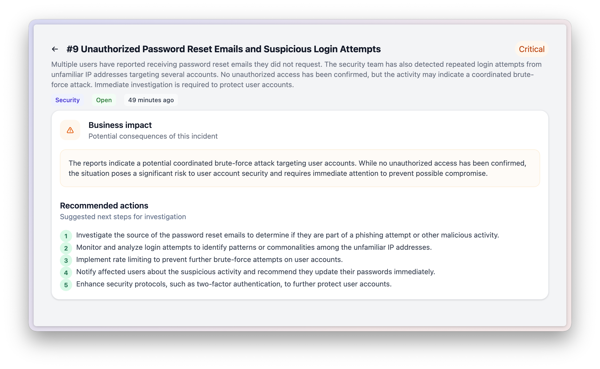

## Issue Triage

A simple Laravel project that demonstrates how to build an AI-first incident management component.



The goal of this repository is not to build the best incident management application. Instead, it focuses on teaching how organize a Laravel application using a component architecture, where an entire feature lives in its own directory.

### Directory Structure

```
components
└── Incidents
    ├── Actions
    │   ├── AnalyzeIncident.php
    │   └── CreateIncident.php
    ├── Agents
    │   └── IncidentTriage.php
    ├── Database
    │   └── Migrations
    │       └── 2026_10_12_133931_create_incidents_table.php
    ├── Enums
    │   ├── IncidentCategory.php
    │   ├── IncidentPriority.php
    │   └── IncidentStatus.php
    ├── Http
    │   └── Controllers
    │       └── IncidentController.php
    ├── IncidentServiceProvider.php
    ├── Models
    │   └── Incident.php
    ├── Routes
    │   └── web.php
    └── Views
        ├── index.blade.php
        ├── layout.blade.php
        ├── list.blade.php
        └── show.blade.php
```



Everything related to the incident management feature lives inside the `components/Incidents` directory. This includes the actions, agents, model, service provider, and migrations. This makes the code easier to understand, maintain, and eventually extract another project if needed.

### License

This project is open-sourced software licensed under the [MIT license](https://opensource.org/licenses/MIT).